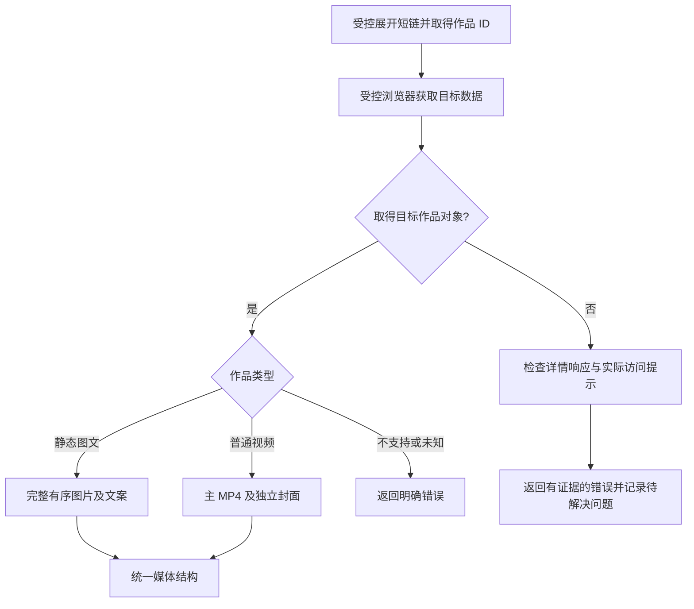

# 统一接口与抖音解析技术设计

状态：2026-10-20 本地实现与真实样本验收完成；统一入口、受控浏览器、完整作品读取和本地容器已验证，目标 VPS 验收待执行。

## 接口兼容

| 入口 | 支持范围 | 请求 | 响应策略 |
| --- | --- | --- | --- |
| `POST /api/v1/parse`（新增） | 自动识别小红书或抖音 | 复用 `url`、`refresh`，不要求 `platform` | 相同 envelope、媒体字段、错误码 |
| `POST /api/v1/xiaohongshu/parse`（保留） | 继续仅小红书 | 原样 | 原 ID 校验、媒体结构、错误文案和语义 |
| `GET /healthz` | 健康检查 | 原样 | 不访问任一平台 |

仍使用同一 `X-API-Key` 与 `XHS_API_KEY`；首版不改环境变量命名。输入是提取后的单条 URL，分享文案本身不属于既有接口契约，暂不扩展为 `text`。调用方可使用本轮分享文案里的 URL。

为最大化复用，统一入口保留 `note_id` 字段，不另起 `aweme_id` 或 `item_id`。抖音 ID 作为字符串保存，避免长整型在 JavaScript 中丢失精度；十进制形式与长度边界由样本确定。不要直接把现有 `ImageNote`、`VideoNote` 的 ID 正则改成任意字符串：保留旧入口严格模型，统一入口复用媒体模型和 envelope，使用适配后的作品模型并执行平台校验。

首版不额外暴露 `platform` 字段：调用方提交的 URL 已确定平台，新增响应字段对严格消费者未必兼容。平台标识存在内部解析结果/上下文中，以支持缓存隔离、校验及日志；若未来需要公开平台字段，再作为独立契约变更评审。

## 媒体映射

| 上游语义 | 公共字段 | 规则 |
| --- | --- | --- |
| 作品 ID | `data.note_id` | 精确选择目标作品，不替代为推荐作品 |
| 作品描述 | `data.title` | 映射原始描述，不拆 hashtags、不 AI 总结；缺失为 null |
| 普通视频 | `type=video`、`videos[0]` | 一个主 MP4，`images=[]`；封面独立放 `cover` |
| 静态图文 | `type=image`、`images[]` | 按上游顺序，`index` 从 1 开始，`videos=[]`、`cover=null` |
| 尺寸/时长/编码/大小 | 既有同名字段 | 仅有可靠证据才填；不从静态封面推断视频尺寸 |
| 签名有效期 | `url_expires_at` | 无明确过期语义则 null；保留 URL 签名参数 |
| 媒体验证 | `verification` | 运行时不下载验证，维持 `not_checked` |

图文背景音乐不输出为顶层视频；不合成图文视频。抖音动态照片及未知混合媒体首版不承诺支持，应明确报 `UNSUPPORTED_CONTENT`，不能悄悄丢失动态部分。小红书已支持的 `images[].live_video` 保持原行为。视频格式必须有正向证据；不做水印处理，也不保证上游直链的水印状态。

媒体完整性规则：每个上游图片槽位对应一个输出图片，跨槽即使 URL 相同也保留，不做全局去重；同槽的多条地址只选一条合格候选。已识别静态图文任一槽位缺失有效图片时返回 `MEDIA_NOT_FOUND`，不跳过坏图压缩索引。图文伴随 `video` 字段需按已证实的语义解释；明确动态/混合内容返回 `UNSUPPORTED_CONTENT`，无法解释的结构返回 `PARSE_FAILED`。

视频多个变体按明确 H.264、未知编码、H.265 的优先级排序，再按分辨率、码率和 URL 确定性选择；URL、格式、尺寸、时长、编码来自同一候选或经确认的作品级来源，不跨候选拼装元数据。

## 请求链路与模块边界

```text
统一入口（自动识别） / 旧入口（限定小红书）
  → 共用鉴权、输入边界、每密钥限流
  → URL 精确校验并选择平台适配器
  → 共用缓存 / 请求合并 / 队列 / Deadline
  → 平台 URL 策略 + 有界传输
  → 平台状态读取 → 目标 ID 校验 → 媒体归一化
  → 内部统一媒体结果 → 对应入口的响应模型
```

实现使用最小的 `Adapter`：URL/缓存身份与 `parse(url, deadline) -> InternalNote` 两个职责。`ParseService` 不再解释平台页面字典。小红书薄封装调用原有模块；抖音的 URL、浏览器、回环 CONNECT 代理、状态读取和媒体归一化位于 `app/parser/douyin/`。

小红书 HTTP 传输继续保持 `Deadline`、DNS 绑定、逐跳检查、响应体上限和取消语义，必要时提取公共机制；不能把小红书的 Referer、页面标记或作品路径作为默认值套给抖音。抖音允许独立浏览器获取层正常加载页面，再将取得的数据交给纯数据解析器；解析器本身不执行上游表达式。浏览器所有连接需有自己的出站约束，不能声称自动继承 curl 的 DNS 绑定能力。

内部平台上下文由调度上下文或结果包装明确携带，不能根据 ID 正则猜平台。统一入口使用适配后的作品/成功 schema，旧入口继续使用旧模型；共享媒体与元信息组件。缓存与请求合并只共享内部结果和领域错误，不共享已经构建的 HTTP 响应：每个入口独立选择文案、响应模型及 request_id，避免一个入口的错误格式污染另一个入口。

## 获取作品数据的决策路径

[早期实测](p0-data-loading-2026-10-19.md)确认移动分享页初始状态没有媒体。实现改用桌面作品页，在限定状态大小内读取 React Flight 目标对象，并同时监听目标详情响应；两条路径都必须精确匹配最终作品 ID。

受控服务端浏览器已在新的匿名上下文、无头模式和本地基础容器中取得完整作品；V1/V2 视频、I1 完整静态图文成功，I2 动态图文明确拒绝。代表视频和图片直链通过独立读取。详见[实现验收证据](implementation-evidence-2026-10-20.md)。



图中链路已通过 P0 并接入正式入口。失败不无限重试、不使用推荐作品替代目标，不从第三方宽泛递归搜索或任意播放 URL 拼接实现。

每个抖音任务创建独立 Chromium 进程及匿名上下文，禁止使用用户日常浏览器配置。启动失败、崩溃、超时与取消均回收上下文、进程、Playwright 驱动和代理；浏览器不可用的回归测试证明旧小红书链路仍可服务。浏览器并发默认为 1，不引入额外用户操作步骤。

交付内容的完成程度按“页面可取 → 作品可定位 → 媒体已提取 → 媒体可读取 → 调用方完整下载/播放”分开记录。运行时保留 `verification=not_checked`；开发阶段的代表样本检查不能自动改变所有响应的验证字段。

## 资源与安全契约

- 整个服务共享一个限流器、一个 admission、一个有界缓存和请求合并表。新增入口不能让同一密钥绕过配额，也不能把上游并发翻倍。
- 保留现有 HTTP 路径的 20 秒总期限、5 秒连接期限、3 次跳转、2 MiB 解压响应上限、2 个上游任务、4 个等待者、120 秒/256 条成功缓存、20 次/分钟/密钥。抖音同样先在 20 秒总预算内验证，浏览器冷启动、导航、数据等待和解析均计时，不在每一步重置超时。
- 浏览器另设有界上下文配额并服从全局准入；在 P0 明确导航次数、详情响应读取上限、子资源单项与累计预算并测试。不能把原 HTML 上限当作浏览器全部网络流量已经受限的证据，也不能无界读取响应后才检查大小。
- 缓存身份建议为 `platform + normalized_full_url_hash`；不得丢弃可能决定访问权限的查询参数，也不只用作品 ID。刷新与普通调用继续区分 in-flight key。旧入口和统一入口对同一小红书 URL 使用同一内部缓存身份，但各自构建响应和请求 ID。
- 初始平台一经选择，重定向只允许该平台明确验证过的 URL，不允许通过跨平台跳转改变适配器。主机是精确白名单；域名后缀或未知 CDN 不能自动信任。
- 新鲜匿名会话不等于完全禁止上游 Set-Cookie；可在单次解析会话内保留正常匿名 Cookie，不能复用用户账号 Cookie。
- 浏览器导航、重定向、脚本、子资源及后续详情请求均须受控；具体出站方案在 P0 实现前确定并验证，禁止只校验第一次导航后就任由浏览器连接内网或未知目标。
- 页面与媒体 URL 检查分离；不会因某主机可返回媒体就允许把它作为任意抓取入口。解析过程不下载完整媒体。

## 错误与部署

沿用 `INVALID_REQUEST`、`INVALID_URL`、`NOTE_NOT_FOUND`、`UNSUPPORTED_CONTENT`、`MEDIA_NOT_FOUND`、`PARSE_FAILED`、`UPSTREAM_*`、`BUSY`、`RATE_LIMITED` 等错误码及 HTTP 状态。缺失作品需明确证据；登录/挑战不可被报成删除。实测 `status_code=0` 但 `aweme_details=null`、`filter_list.reason=8` 不能报成功，也不能在语义未验证时映射为删除或登录；`encrypt_data_miss` 同样不证明必须账号登录。统一入口的错误文案使用中性或平台准确措辞，旧入口保留既有公开文案。不要仅为抖音增加一套平行错误码。

应用需更新 OpenAPI、合约测试、示例、服务标题与日志平台上下文；反向代理需新增统一入口的精确转发。现有网关错误的旧入口文案保留，统一入口使用中性文案。FastAPI 仍为单 worker，无数据库、Redis 或付费外部解析服务；新增浏览器进程按资源预算管理。镜像需包含匹配的浏览器/系统依赖，维持非 root 和沙箱；实测只读根、临时目录、共享内存及内存限制，不假定现有 512 MiB / 64 MiB 临时目录足够。基础容器验证提前到 P0。

## 关键取舍与风险

- 新增统一路由优于要求调用方按平台切换入口；保留旧路由避免强制迁移，代价是维护两套入口响应校验。
- 保留字段名优于立即做平台元数据扩充；代价是 `note_id` 命名带有历史含义，但使用方式一致。
- 直接返回媒体 URL 依赖 CDN 对调用方可访问；如果必须带服务端会话、特殊 Header 或中转才可下载，现有契约可能不足，需重新规划。
- 浏览器候选已确认，完整匿名获取与部署可用性仍是技术风险；登录、验证码处理、签名逆向和付费解析服务未纳入范围。只有真实证据表明现有范围无法达到目标时，再提出具体变更选择。
